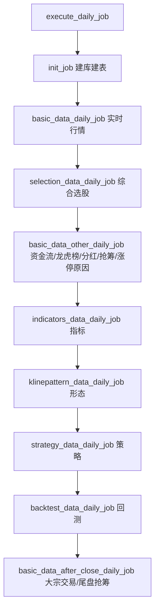
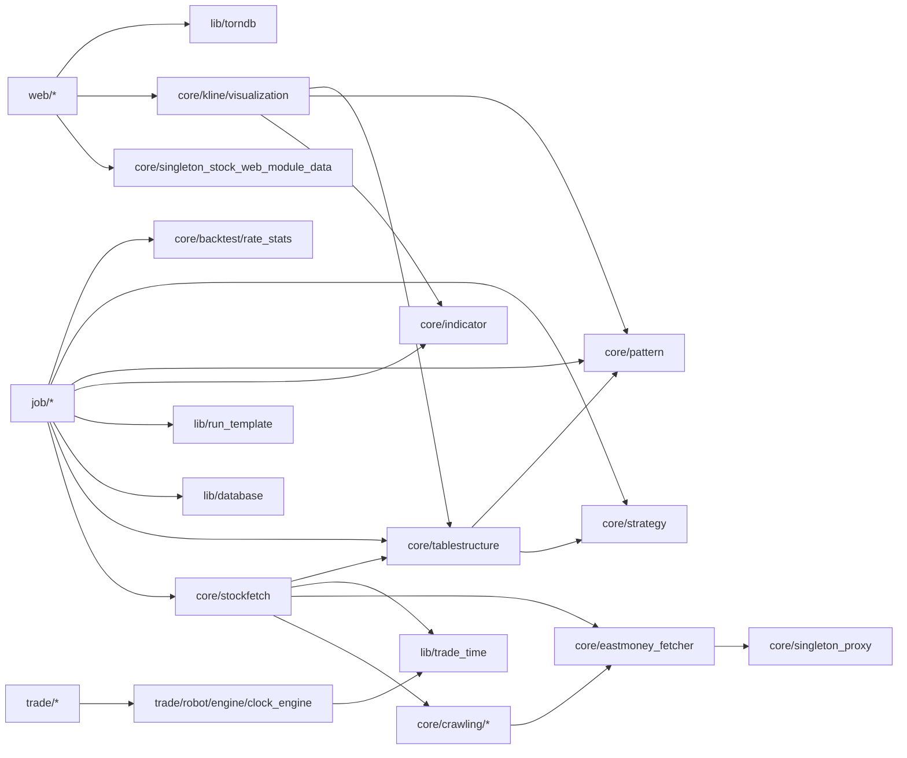

# 01 · 整体架构

## 1. 系统定位与入口

InStock 由三条独立的运行链路组成，共享同一套 `core` 与数据库：

```
                  ┌────────────────────────────────────────────┐
                  │                  MySQL / MariaDB           │
                  │   instockdb（行情/指标/形态/策略/回测/关注） │
                  └──────────▲───────────────▲─────────────────┘
                             │写              │读
        ┌────────────────────┴───┐      ┌────┴──────────────────┐
        │  数据作业链路 job/      │      │  Web 展示链路 web/     │
        │  execute_daily_job.py  │      │  web_service.py:9988  │
        └────────────▲───────────┘      └────▲──────────────────┘
                     │                        │
        ┌────────────┴────────────┐   ┌───────┴───────────────┐
        │        core/            │   │  core/kline           │
        │ stockfetch / crawling   │   │  visualization + cyq  │
        └────────────▲────────────┘   └───────────────────────┘
                     │
        ┌────────────┴────────────┐
        │ 东方财富 / 新浪财经 API  │
        └─────────────────────────┘

        ┌──────────────────────────────────────┐
        │  自动交易链路 trade/                  │
        │  trade_service.py → easytrader → 券商 │
        └──────────────────────────────────────┘
```

| 入口 | 文件 | 职责 |
| --- | --- | --- |
| 批量作业 | [execute_daily_job.py](file:///workspace/instock/job/execute_daily_job.py) | 串起建库、行情、选股、指标、形态、策略、回测、闭盘数据 |
| Web 服务 | [web_service.py](file:///workspace/instock/web/web_service.py) | Tornado HTTP 服务，端口 `9988` |
| 交易服务 | [trade_service.py](file:///workspace/instock/trade/trade_service.py) | 事件驱动交易机器人 |
| 单功能作业 | `instock/job/*_daily_job.py` | 每个数据处理环节可单独运行 |
| 定时调度 | `cron/`、`supervisor/` | 容器内的定时与进程守护 |

---

## 2. 分层架构

```
┌─────────────────────────────────────────────────────────────┐
│ 接入层  job/        web/                 trade/             │
├─────────────────────────────────────────────────────────────┤
│ 领域层  core/                                                │
│   ├─ stockfetch.py         数据获取门面（统一字段/过滤）      │
│   ├─ crawling/             东方财富/新浪原始接口封装          │
│   ├─ indicator/            TA-Lib 指标计算                   │
│   ├─ pattern/              K 线形态识别                      │
│   ├─ strategy/             选股策略                          │
│   ├─ kline/                K 线图 + 筹码分布（Bokeh / 算法）  │
│   ├─ backtest/             未来收益率回测                    │
│   ├─ tablestructure.py     全系统表结构与字段字典             │
│   └─ singleton_*.py        单例缓存                          │
├─────────────────────────────────────────────────────────────┤
│ 基础层  lib/                                                 │
│   database.py / torndb.py  DB 访问                           │
│   trade_time.py            交易日历与交易时段                 │
│   run_template.py          批量日期入口                      │
│   singleton_type.py        单例元类                          │
│   crypto_aes.py            AES 工具                          │
└─────────────────────────────────────────────────────────────┘
```

关键原则：**上层只依赖 `stockfetch`，不直接调用 `crawling`**。这样新增数据源时只需改 `crawling` + `stockfetch`，作业层无需变动。

---

## 3. 数据流（一次完整作业）



每一步的通用“落库三段式”：

1. 通过 `core.stockfetch.fetch_xxx()` 拿到 **已重命名、已过滤** 的 `DataFrame`；
2. 若表存在，先 `DELETE FROM table WHERE date = ?`（保证重跑幂等）；
3. `lib.database.insert_db_from_df()` 追加写入，并自动补主键/索引。

> ⚠️ 当前仓库的 [execute_daily_job.py](file:///workspace/instock/job/execute_daily_job.py#L35-L61) 中，`indicators / klinepattern / strategy / backtest` 四步是**注释状态**，默认只跑建库、实时行情、综合选股、非实时基础数据、闭盘数据。如需完整流水线，可取消注释或单独运行对应 `*_daily_job.py`。

---

## 4. 目录结构

```
.
├── cron/                     # 容器内定时任务脚本
│   ├── cron.hourly/run_hourly        # 盘中每 30 分钟跑实时行情
│   ├── cron.workdayly/run_workdayly  # 工作日 17:30 跑整体作业
│   └── cron.monthly/run_monthly      # 每月清理历史缓存
├── docker/                   # Dockerfile / compose / 构建脚本
├── img/                      # README 截图
├── instock/                  # 主程序包
│   ├── bin/                  # 启动脚本（run_job/run_web/run_trade…）
│   ├── config/               # proxy.txt / eastmoney_cookie.txt / trade_client.json
│   ├── core/                 # 领域核心
│   │   ├── crawling/         # 数据源抓取
│   │   ├── indicator/        # 指标计算
│   │   ├── pattern/          # K 线形态
│   │   ├── strategy/         # 选股策略
│   │   ├── kline/            # K 线可视化 + 筹码
│   │   ├── backtest/         # 回测收益率
│   │   ├── stockfetch.py     # 数据获取门面
│   │   ├── tablestructure.py # 表结构字典
│   │   └── singleton_*.py    # 单例缓存
│   ├── job/                  # 作业编排
│   ├── lib/                  # 基础设施
│   ├── trade/                # 自动交易
│   └── web/                  # Web 服务
│       ├── static/           # 前端静态资源
│       └── templates/        # Jinja/Tornado 模板
├── supervisor/               # supervisord 配置
├── requirements.txt
└── README.md
```

---

## 5. 模块依赖关系

### 5.1 内部依赖图



### 5.2 外部依赖（核心）

| 依赖 | 用途 | 使用位置 |
| --- | --- | --- |
| `pandas` / `numpy` | 数据表与向量化计算 | 全项目 |
| `TA-Lib` (`talib`) | 技术指标、K 线形态 | `core/indicator`、`core/pattern`、`core/tablestructure` |
| `SQLAlchemy` + `PyMySQL` | `DataFrame.to_sql` / 原始 SQL | `lib/database.py` |
| `tornado` | Web 服务 | `web/` |
| `bokeh` | K 线与筹码图 | `core/kline/visualization.py` |
| `requests` | HTTP 抓取 | `core/eastmoney_fetcher.py` |
| `easytrader` | 券商客户端自动化 | `trade/` |
| `logbook` | 交易日志 | `trade/robot/infrastructure/default_handler.py` |

---

## 6. 核心设计模式

### 6.1 单例元类

[singleton_type.py](file:///workspace/instock/lib/singleton_type.py) 是一个线程安全的元类：第一次 `Class(...)` 时创建实例，之后始终返回同一实例。

```python
class singleton_type(type):
    single_lock = RLock()
    def __call__(cls, *args, **kwargs):
        with singleton_type.single_lock:
            if not hasattr(cls, "_instance"):
                cls._instance = super().__call__(*args, **kwargs)
        return cls._instance
```

使用者：

| 单例 | 缓存内容 | 备注 |
| --- | --- | --- |
| `proxys` | 代理池 | 从 `config/proxy.txt` 读取，随机选择 |
| `stock_data` | 当日全市场行情 | 参数 `date` **只对首次生效** |
| `stock_hist_data` | 全部股票历史行情 | 首次调用时按日期抓取全部股票 |
| `stock_trade_date` | 交易日历集合 | 来自新浪接口 |
| `stock_web_module_data` | Web 视图字典 | 启动时一次性构建 |

> ⚠️ 这是理解批量作业的关键：单例只按**第一次**参数初始化。所以批量跑历史日期时，`stock_hist_data(date=...)` 实际拿到的是首个日期的缓存，作业里会用 `if date != data.iloc[0]['date']: data['date'] = date_str` 来“修正日期”。（源码注释：“单例，时间段循环必须改时间”。）

### 6.2 视图字典驱动 Web

[web_module_data.py](file:///workspace/instock/core/web_module_data.py) 描述一个页面的元信息（表名、字段、中文名、排序、是否实时）。新增业务表时，只需在 [singleton_stock_web_module_data.py](file:///workspace/instock/core/singleton_stock_web_module_data.py) 增加一条，即可自动获得左侧菜单、表格页面、查询 API。

### 6.3 表结构即配置

[tablestructure.py](file:///workspace/instock/core/tablestructure.py) 中每个表都是 `{'name', 'cn', 'columns'}` 字典，`columns` 同时提供：数据库类型（SQLAlchemy）、中文名、列宽、形态识别函数等。建表、写库、Web 列头、图表字段名全部由它派生。

### 6.4 批量日期模板

[run_template.py](file:///workspace/instock/lib/run_template.py) 的 `run_with_args` 统一解析命令行参数，三种模式见 [03-job-module.md](file:///workspace/docs/code-wiki/03-job-module.md)。
