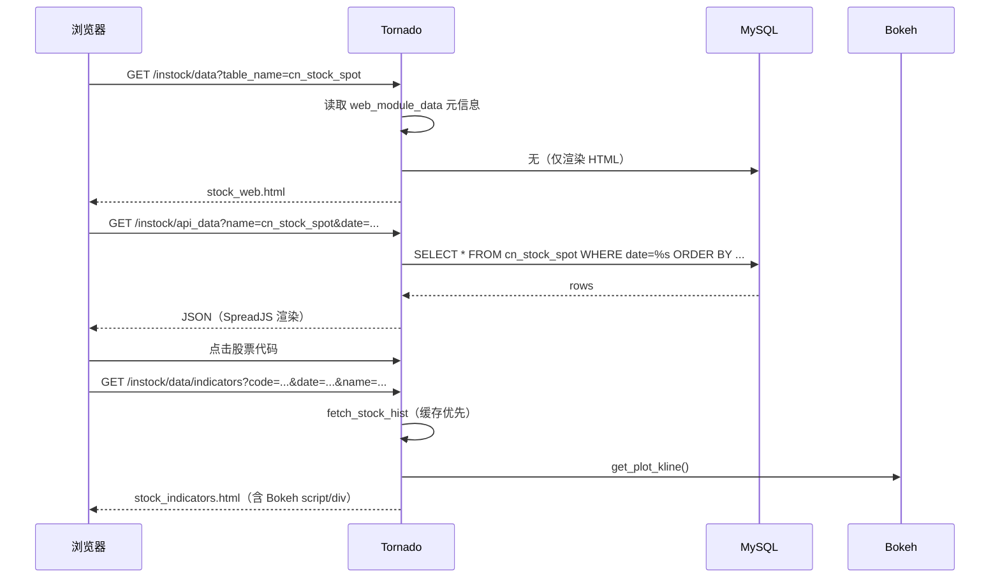

# 04 · web 模块

`instock/web/` 是基于 **Tornado** 的只读展示层：从 MySQL 读数据，用前端表格控件（GC.Spread.Sheets）展示；个股详情页用 **Bokeh** 渲染 K 线、指标与筹码。

---

## 1. 启动与端口

```python
# web_service.py
http_server = HTTPServer(Application())
http_server.listen(9988)
IOLoop.current().start()
```

- 默认端口：**9988**
- 日志：`instock/log/stock_web.log`（级别 `ERROR`）
- 调试：`debug=True`、`xsrf_cookies=False`

对应启动脚本：[run_web.sh](file:///workspace/instock/bin/run_web.sh) / `run_web.bat`。

---

## 2. 路由表

| 路由 | Handler | 作用 |
| --- | --- | --- |
| `/`、`/instock/` | `HomeHandler` | 首页 |
| `/instock/api_data` | `dataTableHandler.GetStockDataHandler` | 返回某表的 JSON 数据 |
| `/instock/data` | `dataTableHandler.GetStockHtmlHandler` | 渲染通用表格页面 |
| `/instock/data/indicators` | `dataIndicatorsHandler.GetDataIndicatorsHandler` | 个股 K 线/指标/筹码详情页 |
| `/instock/control/attention` | `dataIndicatorsHandler.SaveCollectHandler` | 加入/取消关注 |

定义位置：[web_service.py:37-48](file:///workspace/instock/web/web_service.py#L37-L48)。

---

## 3. 应用与基类

### 3.1 `Application`

[web_service.py](file:///workspace/instock/web/web_service.py#L35-L59)：

- 配置 `template_path`、`static_path`、`cookie_secret`；
- 创建一个全局 `torndb.Connection`（`self.db`）供所有 Handler 复用。

### 3.2 `BaseHandler`

[base.py](file:///workspace/instock/web/base.py)：

```python
class BaseHandler(tornado.web.RequestHandler, ABC):
    @property
    def db(self):
        try:
            self.application.db.query("SELECT 1 ")
        except Exception:
            self.application.db.reconnect()
        return self.application.db
```

- 每次访问都做一次 `SELECT 1` 健康检查，失败自动重连；
- 同时提供 `GetLeftMenu(url)`，基于单例 `stock_web_module_data` 生成左侧菜单。

---

## 4. Handler 说明

### 4.1 `HomeHandler`

渲染 `index.html`，传入 `stockVersion` 与 `leftMenu`。

### 4.2 `GetStockHtmlHandler`

```
GET /instock/data?table_name=cn_stock_spot
```

1. 从 `stock_web_module_data` 取页面元信息；
2. 根据 `is_realtime` 决定默认日期：实时表用 `run_date_nph`，否则用 `run_date`；
3. 渲染 `stock_web.html`。

### 4.3 `GetStockDataHandler`

```
GET /instock/api_data?name=cn_stock_spot&date=2024-01-01
```

- 拼接 SQL：

```sql
SELECT *, <order_columns> FROM `<table_name>` [WHERE `date` = %s] [ORDER BY <order_by>]
```

- 参数化查询防注入；
- `MyEncoder` 处理 `bytes`（`0/1` → 否/是）和 `date`（转 `/OADate(...)/`，供 SpreadJS 识别为日期）。

### 4.4 `GetDataIndicatorsHandler`

```
GET /instock/data/indicators?code=600000&date=2024-01-01&name=浦发银行
```

1. 以代码首位区分 ETF（`1`/`5` 开头走 `fetch_etf_hist`）与股票（`fetch_stock_hist`）；
2. 调用 `core/kline/visualization.get_plot_kline()` 生成 Bokeh 组件；
3. 渲染 `stock_indicators.html`。

> 由于该接口会**实时抓取历史行情**（优先读本地缓存），首次访问某只股票可能稍慢。

### 4.5 `SaveCollectHandler`

```
GET /instock/control/attention?code=600000&otype=0   # 0=关注, 1=取关
```

- `otype == '1'` 删除，否则插入 `cn_stock_attention`；
- 固定返回 `{"data":[{}]}`。

---

## 5. 视图字典：页面如何自动生成

Web 页面不是硬编码的，而由 `web_module_data` 描述：

```python
web_module_data(
    mode="query",
    type="股票基本数据",          # 左侧菜单分组
    ico="fa fa-book",            # 菜单图标
    name="每日股票数据",           # 页面标题
    table_name="cn_stock_spot",  # 数据表
    columns=(...),               # 字段顺序
    column_names=(...),          # SpreadJS 列头定义
    primary_key=[],
    is_realtime=True,            # 默认日期取实时/非实时
    order_columns="(SELECT ...) AS cdatetime",  # 关注置顶
    order_by=" `cdatetime` DESC",
)
```

`stock_web_module_data` 在启动时构建 `data_list`（菜单）与 `data`（按表名索引），并在末尾追加全部策略表。改动页面只需改这一处。

---

## 6. 模板结构

```
templates/
├── common/
│   ├── meta.html          # <head>、全局 CSS/JS
│   ├── header.html        # 顶部栏
│   ├── left_menu.html     # 左侧菜单（遍历 leftMenu）
│   └── footer.html
├── layout/
│   ├── default.html       # 组合 common + main
│   ├── main.html          # 主内容块
│   ├── indicators-main.html
│   └── indicators.html
├── index.html             # 首页
├── stock_web.html         # 通用表格页
└── stock_indicators.html  # 个股详情页
```

- `default.html` 通过多次 `` 组合公共片段（Tornado 模板特性）；
- `stock_web.html` 使用 `GC.Spread.Sheets` 构建表格，并实现：
  - 代码列超链接 → 打开 `/instock/data/indicators`；
  - 日期选择器切换 `date` 参数；
  - “重置筛选”“保存 Excel”（`gc.spread.excelio` + `FileSaver.js`）；
  - `ResizeObserver` 自适应宽度。
- `stock_indicators.html` 直接输出 Bokeh 的 `script` 与 `div`。

---

## 7. 前端静态资源

`static/` 主要包含：

| 资源 | 用途 |
| --- | --- |
| `gc.spread.sheets.*` | 商业表格控件（评估版） |
| `bokeh-3.8.1.min.js`、`bokeh-widgets-3.8.1.min.js` | K 线图交互 |
| `jquery.min-3.7.1.js`、`bootstrap.min-3.4.1.js` | 基础 UI |
| `bootstrap-datepicker*` | 日期选择 |
| `FileSaver.js` | 导出 Excel |
| `ace.*`、`font-awesome` | 主题与图标 |

> 表格控件为第三方商业控件，仓库中仅用于评估学习。

---

## 8. 请求时序



---

## 9. 扩展指引

- **新增一张表的展示页**：在 `singleton_stock_web_module_data.py` 中追加一个 `web_module_data`，无需改路由/模板。
- **新增一个 API**：在 `web_service.py` 的 `handlers` 列表注册路由，Handler 继承 `webBase.BaseHandler`。
- **注意安全**：当前 `debug=True`、`xsrf_cookies=False`，仅适合内网/本机使用；对外暴露前应关闭 debug 并开启 XSRF。
